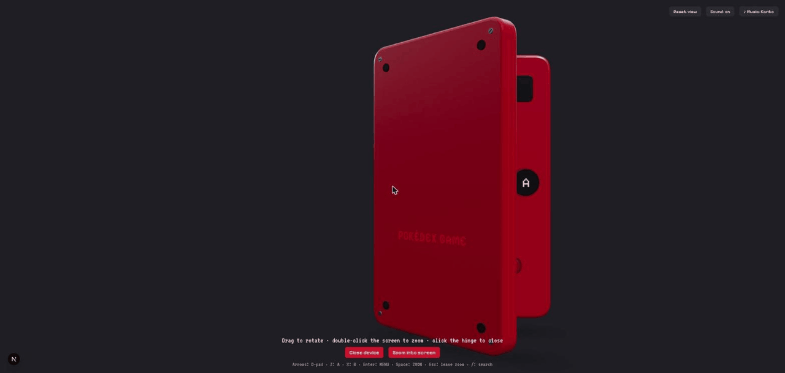
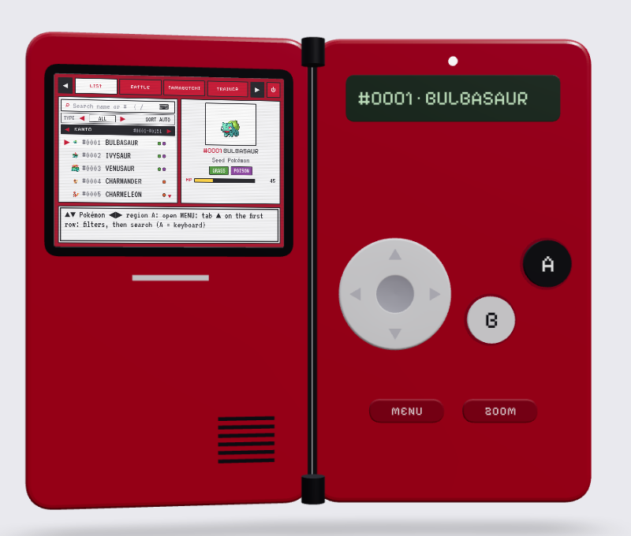
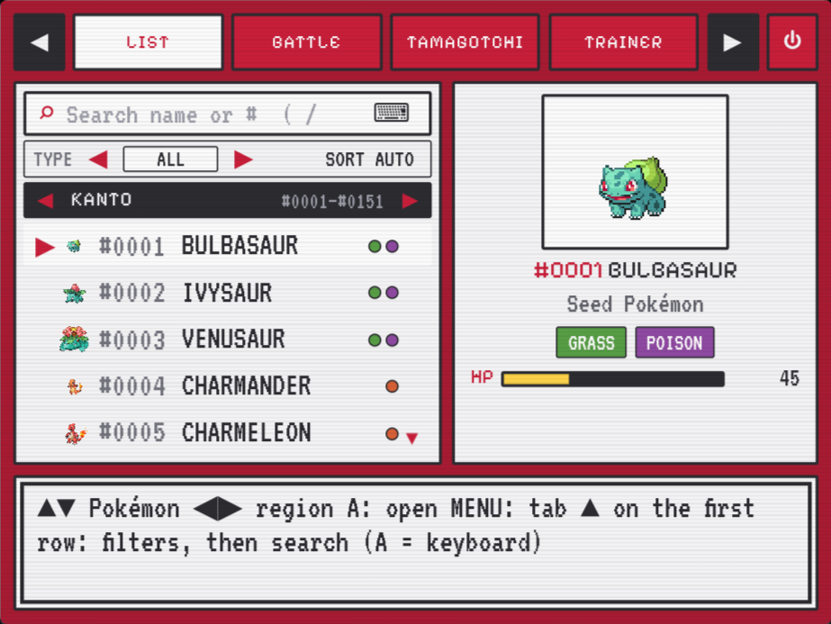
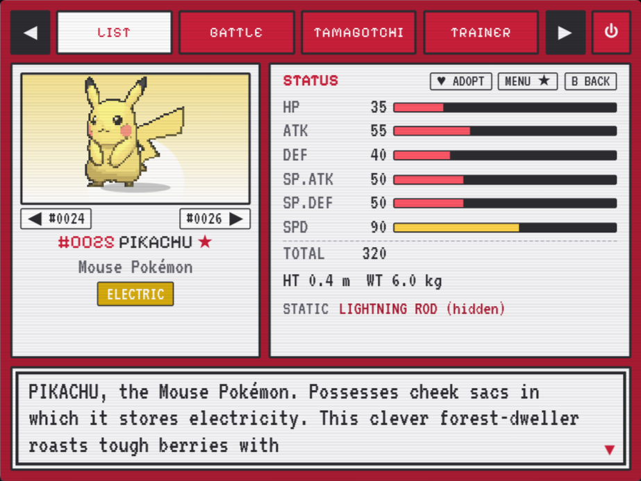
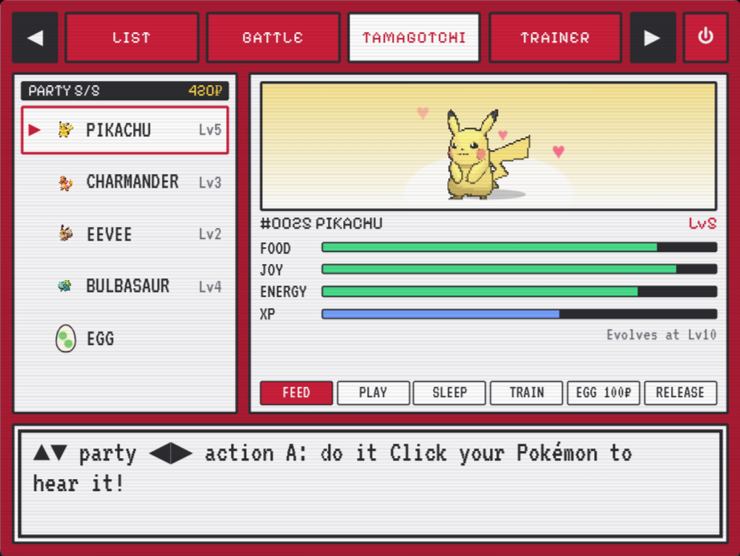
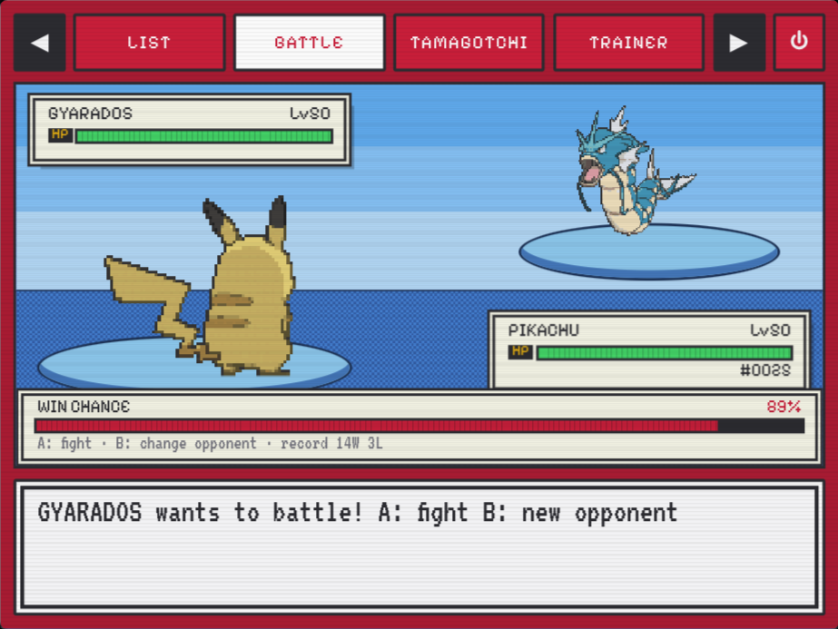
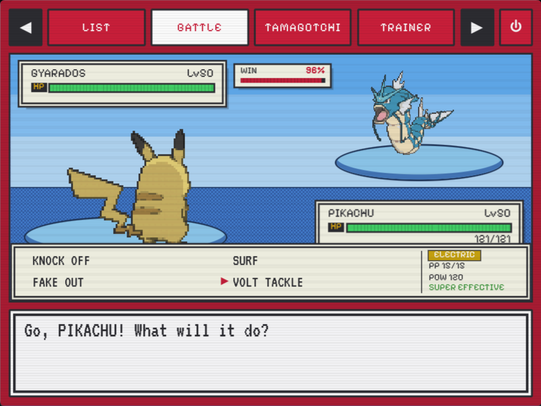
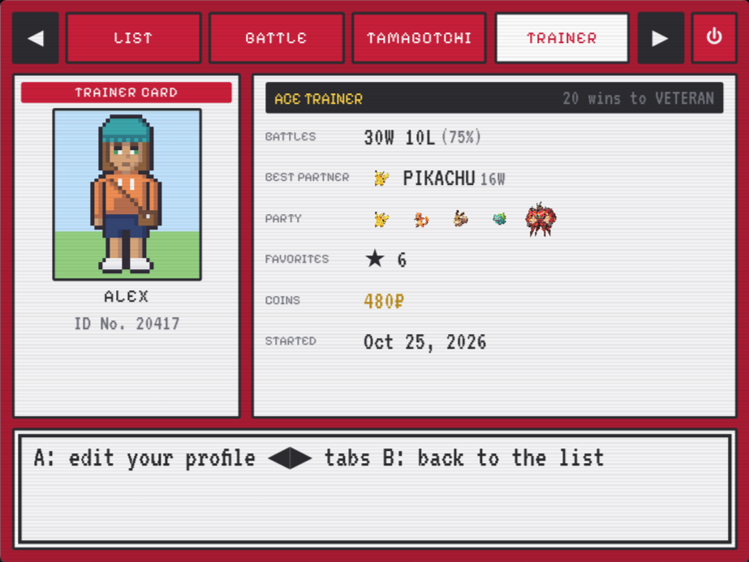
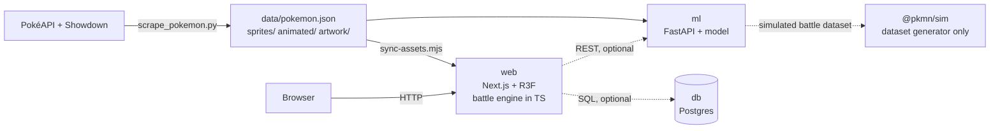

# Pokédex Game

An interactive 3D Pokédex with turn-based battles, in-browser win-probability prediction and a Tamagotchi. Built as a portfolio project with a procedural React Three Fiber device, a hand-written battle engine and a machine-learning pipeline.

> Non-profit fan project, not affiliated with Nintendo, Game Freak or The Pokémon Company. See the [legal notice](#legal-notice).



**Status:** in development. The scraper, the 3D device, the Pokédex, the Tamagotchi, the trainer profile and 1v1 / 3v3 / 6v6 battles with win prediction are working, along with a league, a daily challenge and a progression loop that ties them together. The whole stack runs with Docker Compose, and the Tamagotchi syncs across devices through Postgres.

## Table of contents

- [Highlights](#highlights)
- [Features](#features)
- [Screenshots](#screenshots)
- [Architecture](#architecture)
- [Tech stack](#tech-stack)
- [Project structure](#project-structure)
- [Getting started](#getting-started)
- [Controls](#controls)
- [Win-prediction model](#win-prediction-model)
- [Data structures and algorithms](#data-structures-and-algorithms)
- [Development workflow](#development-workflow)
- [Roadmap](#roadmap)
- [Legal notice](#legal-notice)
- [Credits](#credits)

## Highlights

- **Procedural 3D device** with a spring hinge, pressable buttons, a zoom camera, positional sound and a phone layout. No external model needed.
- **Full Pokédex** for all 1025 Pokémon (generations 1 to 9): prefix search, regions with music, filters, favorites and generated fun facts.
- **Own battle engine** in pure TypeScript with standard gen 5+ rules, a foe AI and unit tests. Supports 1v1, 3v3 and 6v6.
- **Win prediction** by a gradient-boosting model that runs entirely in the browser, plus a live Monte Carlo re-estimate every turn. It also sets the prize: the less likely the win, the bigger the reward.
- **A progression loop:** beat a Pokémon to catch it, adopt what you caught, keep your party fed and rested so it fights well, spend the coins in the shop, climb an eight-leader league and come back for the daily challenge.
- **Tamagotchi and trainer profile** with evolution, eggs, coins, a customizable pixel sprite and a trainer card. With a database, the party syncs across devices.
- **Runs anywhere:** no backend needed (everything works from `localStorage`), or the full stack with one `docker compose up`.

## Features

### Device and interface

| Area | Description |
| --- | --- |
| 3D device | Original red handheld built with React Three Fiber. The screen half opens like a book cover on a spring hinge (a full-height barrel with knuckles alternating between the halves, screwed to each), with idle float, boot animation, a secondary screen and a status LED that pulses red in battle and amber when a Tamagotchi needs you. Engraved lettering, screws, parting lines and buttons that sink and darken when pressed. Drag to rotate, zoom into the main screen. Every measurement lives in `device.config.ts`. |
| Phone layout | On touch screens in portrait, the controls move next to the screen, the lid opens flat and the camera frames one half. Force it with `?layout=compact` or `?layout=split`. |
| Input | Keyboard, gamepad and 3D buttons emit the same events through a priority-based handler stack. Held directions repeat. |
| Sound | Synthesized UI sounds and music (WebAudio), and Pokémon cries played from the speaker grill. Nothing from the games is bundled. |
| Accessibility | Respects `prefers-reduced-motion`: no float, instant hinge and camera, no boot animation. |

### Pokédex

| Area | Description |
| --- | --- |
| Browse | Scrollable list with a preview panel and a detail page: animated sprite, types, base stats, height, weight, abilities and a typewriter dex entry. |
| Search | Prefix search by name (binary search, A→Z) or lookup by number (`25`, `#25`). Real keyboard (`/` to focus) or on-screen keyboard. |
| Regions and music | Region of the focused Pokémon, jump between regions with ◀ ▶, and crossfading chiptune loops per region. |
| Filters and favorites | Filter by type, ★ favorites or caught, sort by number, name or base stat total. Favorites persist in `localStorage`. |
| Seen and caught | Foes you meet in battle are **seen**; the ones you beat, and everything your Tamagotchi party hatches or evolves into, are **caught**. The list marks both, the region bar counts the region's caught share and the trainer card shows the totals. |
| Fun facts | Three "Did you know?" facts per Pokémon, computed by comparing it with all 1025 (stat rankings, rare typings, size extremes, catch rate…). |

### Battles

| Area | Description |
| --- | --- |
| Modes | Single (1v1), team (3v3) and full (6v6) battles against a chosen or random opponent, with backdrops picked from the foe's type and original battle themes. |
| League | Eight original leaders with themed 3v3 teams (normal up to dragon), unlocked in order. The first win against each pays a bonus that grows along the way; beaten leaders can be fought again. |
| Daily challenge | A 3v3 against a foe team picked from the date with a seeded generator: the same for everyone that day, with no server. The first win of the day pays a bonus. |
| Fight menu | Classic FIGHT / BAG / POKéMON / RUN flow with type-effectiveness hints, Super Potions, Full Heals and switching. Turns play back event by event. |
| Engine | Hand-written, pure TypeScript (`web/lib/battle`). Priority and speed, damage formula, STAB, type chart, crits, accuracy, stat stages, PP, status conditions (freeze included), drain, recoil, multi-hit, flinch, confusion, Protect, Substitute, Leech Seed, locked, recharge and two-turn moves. Abilities (Intimidate, Levitate, Sturdy, Multiscale, weather setters...) and held items (Leftovers, Life Orb, Choice items, Focus Sash, berries...). The field: entry hazards, screens, weather, Trick Room, Tailwind, Wish. Pivots (U-turn, Volt Switch) and forced switches (Roar, Dragon Tail, Red Card). |
| Foe AI | Greedy: takes the surest KO when available, avoids useless status moves, and in team battles sends out its best matchup and switches out of losing ones. |
| Win chance | Shown before the fight (ML model) and re-estimated every turn (Monte Carlo, 600 simulations per estimate in the browser). Team win chances are simulated, since the model is 1v1. |
| Rewards | Coins and party XP scale with the pre-battle win chance: an even fight pays the base amount, a sure win ×0.2, an upset up to ×2 (shown before you fight). Beaten foes are caught. Party members gain joy (they can evolve) and every Pokémon keeps a win/loss record. |
| Party condition | A Tamagotchi party member fights as well as it is looked after: hungry or tired ones get −15% Attack, Sp. Atk and Speed, happy well-kept ones +10%. A battle costs it energy and food. With a condition in play the 1v1 win chance is simulated, since the model only knows plain sets. |

### Tamagotchi and trainer

| Area | Description |
| --- | --- |
| Tamagotchi | Adopt up to 5 of the Pokémon you caught. Food, joy and energy decay in real time; feed, play, sleep and train. XP raises the level and triggers evolution. Eggs hatch into random base-stage Pokémon, with a 1 in 16 chance of a ✦ shiny one (it keeps its colors when it evolves). Alerts when one needs attention. Saved in `localStorage`; with a database it is also saved in Postgres, so the same party shows up on every device that uses your sync code. |
| Shop | In the Tamagotchi tab: eggs, treats (+40 food, +25 joy for the selected Pokémon) and extra Super Potions and Full Heals for the battle bag, on top of the standard one. Bought items are only used up once the standard ones are gone. |
| Trainer profile | Pick a name and design an original 24×40 pixel sprite (hair, hat, clothes, shoes, extras), or randomize it. The trainer card has four pages (▲▼): **stats** (rank from Rookie to Champion, league progress, wins and losses, win streak, best partner, party, Pokédex progress and favorites, coins, start date), **badges**, **history** (the last 30 battles with the teams, the pre-battle win chance and the result) and **diary** (your sync code and the party's milestones: adoptions, eggs, hatchings, evolutions, level-ups and goodbyes). Your trainer stands in the arena before each battle and sends your Pokémon out by name. |
| Badges | Eight badges, kept once earned: first win, a 3v3 win, a 6v6 win, beating a legendary or mythical, winning with under 30% win chance, 5 wins in a row, a full Tamagotchi party and 10 favorites. New ones are announced in the dialog box. |

## Screenshots

| 3D device | Pokédex list |
| --- | --- |
|  |  |

| Pokémon details | Tamagotchi |
| --- | --- |
|  |  |

| Pre-battle win chance | Fight menu |
| --- | --- |
|  |  |

| Trainer card |
| --- |
|  |

## Architecture



The battle engine and the win model run in the browser, and everything is saved in `localStorage`, so the app works with no backend at all. Two services are optional: FastAPI for the win model, and Postgres for the Tamagotchi sync (one route handler, `web/app/api/tamagotchi`).

Inside `web`, the code is split into four layers:

- **Stores (zustand):** `deviceInput` (button events, repeat, subscriptions), `deviceState` (phase machine `CLOSED → OPENING → OPEN → ZOOMING_IN → ZOOMED → ZOOMING_OUT → OPEN → CLOSING`), `pokedex`, `favorites`, `dexProgress` (seen and caught), `tamagotchi`, `tamaSync`, `inventory` (shop items), `battleRecord`, `battleLog`, `league`, `daily` and `audio`.
- **Device (`components/device`):** procedural 3D shell, hinge, buttons and camera rig, loaded lazily.
- **Screen (`components/screen`):** the 2D UI rendered inside the main screen. It subscribes to input with higher priority than the device controller, so the UI gets the first say on each button.
- **Logic (`lib/`):** pure, unit-tested modules with no React: search, regions, listing, fun facts, Pokédex progress, Tamagotchi rules (including the battle condition), trainer, league, daily challenge, sound and music synthesis, the Tamagotchi sync protocol, the battle engine (rules, AI, Monte Carlo, rewards) and the battle features shared with the ML pipeline.

## Tech stack

| Layer | Technologies |
| --- | --- |
| Front end | Next.js 16 (App Router), React 19, TypeScript, React Three Fiber, drei, three.js, camera-controls, zustand |
| Battle | Own TypeScript engine; `@pkmn/sim` only to generate the ML dataset |
| ML | Python, scikit-learn, pandas, FastAPI; Node dataset generator with `@pkmn/sim` |
| Persistence | `localStorage`; Postgres (`pg`) for the Tamagotchi sync, optional |
| Infrastructure | Docker and Docker Compose |
| Data scraping | Python 3, standard library only |

## Project structure

```
pokedex-game/
├── scrape_pokemon.py       # scrapes data and images from PokéAPI / Showdown
├── data/pokemon.json       # 1025 Pokémon (raw cache in data/cache/, git-ignored)
├── sprites/  artwork/      # static sprites (with back views) and official artwork
├── animated/               # animated sprites (git-ignored)
├── web/                    # Next.js app
│   ├── app/                # App Router entry, api/tamagotchi (sync)
│   ├── components/
│   │   ├── device/         # 3D shell; all measurements in device.config.ts
│   │   └── screen/         # UI inside the 4:3 screen
│   ├── hooks/              # input, device controller and layout, sound, music, Tamagotchi alert
│   ├── stores/             # zustand stores
│   ├── lib/                # search, regions, listing, fun facts, Tamagotchi, trainer, audio, battle/ (+ tests)
│   ├── scripts/            # sync-assets.mjs: copies images, builds public/data/pokedex.json
│   └── AGENTS.md           # guidance for coding agents
├── ml/                     # win prediction (see ml/README.md)
│   ├── generate/           # Node: simulates battles with @pkmn/sim, writes datasets
│   ├── pokedex_ml/         # Python: training, Monte Carlo evaluation, FastAPI
│   ├── tests/              # pytest
│   └── reports/            # metrics
├── CLAUDE.md               # conventions for coding agents
├── docker-compose.yml      # web + ml + db
└── README.md
```

## Getting started

### 1. Scrape the data

Requires Python 3 and no extra dependencies.

```bash
python3 scrape_pokemon.py              # all 1025 Pokémon
python3 scrape_pokemon.py --limit 151  # first generation only
python3 scrape_pokemon.py --no-images  # JSON only
python3 scrape_pokemon.py --workers 4  # fewer parallel requests
```

The script is resumable: API responses are cached in `data/cache/` and existing images are skipped. Only default forms are included (no megas or regional forms). 1017 of 1025 Pokémon have an animated sprite; the other 8 (#990, #991, #993, #1010, #1017, #1022, #1023, #1025) fall back to the static one. Cries are streamed from `cry_url` and not downloaded.

### 2. Run the web app

Requires Node.js and npm.

```bash
cd web
npm install
npm run dev      # http://localhost:3000
```

`npm run dev` and `npm run build` first run `npm run sync-assets`, which copies `sprites/` and `animated/` into `web/public/` and builds a trimmed `web/public/data/pokedex.json`. Without the scraped data the Pokédex fails to load.

```bash
npm run lint     # ESLint
npm test         # unit tests (lib/)
npm run build    # production build
npm run start    # serve the production build
```

> **Deploying (e.g. Vercel):** `animated/` is git-ignored (~72 MB), so a deploy loads the GIFs from remote URLs and falls back to static PNGs if they are offline. The build needs `sprites/` and `data/` from outside `web/`, so keep Vercel's "Include source files outside of the Root Directory" enabled when the Root Directory is `web`. The Tamagotchi sync is off unless `DATABASE_URL` points to a hosted Postgres; without it everything stays in `localStorage`.

### 3. Win-prediction service (optional)

The app already ships the exported model. To retrain it or serve it through FastAPI, follow [`ml/README.md`](ml/README.md). With the service on port 8000, set `NEXT_PUBLIC_ML_API_URL` (default `http://localhost:8000`).

### 4. Full stack with Docker

Requires Docker with Compose, and the scraped data (step 1; `animated/` is optional).

```bash
cp .env.example .env
docker compose up --build      # http://localhost:3000
```

This starts three services: `web` (the Next.js standalone server, [`web/Dockerfile`](web/Dockerfile)), `ml` (FastAPI, [`ml/Dockerfile`](ml/Dockerfile)) and `db` (Postgres 17, data in the `db-data` volume). The tables are created on the first request.

| Variable | Purpose |
| --- | --- |
| `DATABASE_URL` | Postgres connection used by `web` |
| `ML_API_URL` | URL of the FastAPI service as seen from the browser (inlined when `web` is built; empty = model in the browser) |
| `CORS_ORIGINS` | Origins allowed to call the `ml` service |
| `POSTGRES_USER` / `POSTGRES_PASSWORD` / `POSTGRES_DB` | Credentials for the `db` service |
| `WEB_PORT` / `ML_PORT` / `DB_PORT` | Host ports (3000, 8000, 5433) |

To use the database from `npm run dev`, start only `db` (`docker compose up -d db`) and set `DATABASE_URL` in `web/.env.local` (see [`web/.env.example`](web/.env.example)).

### Tamagotchi sync

With a database, the Tamagotchi party is saved in Postgres under a **sync code** (e.g. `K7QM-2HXA-9RTB`), shown on the trainer card's DIARY page next to the party's milestones (adoptions, eggs, evolutions, level-ups). To share the party with another device, open the profile editor there and type the code in SYNC CODE; that device's own party is replaced. Without a database (e.g. a static deploy) the save and the diary stay in `localStorage`.

Each write names the revision it was based on; if another device wrote first, the server's copy wins and the device takes it (`web/lib/tamaSync.ts`, tested in `tamaSync.test.ts`). The code is the only credential, so treat it like a password; the server stores just its hash.

## Controls

Keyboard, gamepad and the 3D buttons emit the same events.

| Keyboard | Device button | Action |
| --- | --- | --- |
| ↑ ↓ ← → | D-pad | Navigate (hold to repeat: 300 ms, then every 90 ms). In the list, ↑ ↓ move and ← → jump between regions; ↑ on the first row reaches the filter/sort row, then the search field. On a Pokémon page they step through the National Dex. |
| `Z` | A | Confirm, open details, advance dialog, type a key |
| `X` | B | Go back (clears the search, deletes a letter); at the root, leave zoom |
| `Enter` | MENU | Next tab (List, Battle, Tamagotchi, Trainer); on a Pokémon page, toggle ★ favorite |
| `Space` | ZOOM | Zoom in or out of the screen (opens the device if closed) |
| `Esc` | n/a | Leave zoom (in the search field: clear, then leave) |
| `/` | n/a | Focus the search field |

Gamepads with the standard mapping also work: D-pad or left stick, A/B, Start = MENU, Select or Y = ZOOM. To open the device: click the cover, press A, or use the page button. To close it: the ⏻ button on the screen, a click on the hinge, or the page button.

<details>
<summary>Per-tab controls</summary>

- **Battle:** pick SINGLE, TEAM (3v3) or FULL BATTLE (6v6), then your Pokémon and the opponent (A confirms, B goes back or undoes the last pick). LEAGUE lists the leaders (A challenges the next one or a beaten one); DAILY CHALLENGE shows today's foes, then you pick your three. In the arena, A starts the battle; the D-pad moves through FIGHT / BAG / POKéMON / RUN, A confirms, B goes back, and A skips messages while a turn plays. When it ends, A fights again and B returns to the lists.
- **Tamagotchi:** ↑ ↓ pick a Pokémon, ← → pick an action, A does it, B goes back. In the SHOP, ↑ ↓ pick an item, A buys it and B closes it.
- **Trainer:** ↑ ↓ flip the card's pages (stats, badges, battle history, Tamagotchi diary); A creates or edits the profile. In the editor, ↑ ↓ pick a row, ← → change it, A on NAME or SYNC CODE opens the keyboard, MENU saves and B cancels.

</details>

The mapping may still change during development.

## Win-prediction model

Full details, commands and results are in [`ml/README.md`](ml/README.md).

1. **Shared battle contract:** `BattleSnapshot` in `web/lib/battleFeatures.ts` is the engine-neutral 1v1 state. Features (turns to KO, damage share, turn order, HP, type advantage, stats, status, moveset features) are computed there once and used by both the dataset generator and the app.
2. **Baseline (hard labels):** ~80,000 battles simulated with `@pkmn/sim` (gen 9). Gradient boosting reached AUC 0.93 with ~0.14% calibration error, against 0.79 for a "who wins the damage race" heuristic, cross-validated by battle (GroupKFold) and tested on unseen species.
3. **Shipped model (soft labels):** trained on the battles the app actually plays (its own engine and movesets). Each of 25,000 random matchups is simulated 100 times with the AI on both sides and the win rate is the label. The sets carry abilities and held items, and the features use the engine's own damage and speed. Mean error 0.083 against 1,000-simulation estimates (correlation 0.94). Battles with abilities and items are more random than before, so the error is higher than the 0.065 of the earlier, simpler engine.
4. **Serving:** trees are exported to JSON and evaluated in the browser (`web/lib/winModel.ts`, tested to match scikit-learn). FastAPI (`/predict`) is used instead when `NEXT_PUBLIC_ML_API_URL` is set.
5. **During the fight:** after each turn, a Monte Carlo run of the rest of the battle refines the estimate in chunks (`web/lib/battle/montecarlo.ts`), cancelled when a newer turn arrives.

If movesets change, regenerate the dataset and retrain the model (see `ml/README.md`).

## Data structures and algorithms

### Prefix search with binary search

[`web/lib/search.ts`](web/lib/search.ts), tested in `web/lib/search.test.ts`.

On load, an index is built once: Pokémon **sorted by normalized name** (lowercase, accents removed, so "flabe" finds Flabébé). A prefix search uses binary search to find the first name `>= prefix` (a _lower bound_), then scans forward while names still match. All matches are contiguous, so the scan touches only the results.

| Operation | Cost |
| --- | --- |
| Sort (once) | `O(n log n)` |
| Find the start of the range | `O(log n)` |
| Collect the `k` results | `O(k)` |
| Full search | `O(log n + k)` |

A numeric query (`25`, `#25`, `#0025`) is an exact `Map` lookup, `O(1)`. A trie was not needed: at 1025 items it would cost more memory for little gain.

### Region of a Pokémon

Regions are contiguous dex ranges sorted by start ([`web/lib/regions.ts`](web/lib/regions.ts)). The region of an id is a binary search for the last range starting at or before it, `O(log r)`. Tests check every boundary (e.g. #151 Kanto, #152 Johto) against a linear scan, and the search tests compare against a brute-force filter on 500 prefixes.

## Development workflow

This project is developed in pair with an AI coding agent ([Claude Code](https://claude.com/claude-code)). I set the direction (product, roadmap, design decisions) and review every change; the agent reads the codebase, implements, runs the linter and the dev server, and fixes what breaks.

- **Small, reviewable commits** following [Conventional Commits](https://www.conventionalcommits.org/) (`feat(screen): …`, `fix(screen): …`, `docs: …`).
- **Agent guidance lives in the repo:** [`CLAUDE.md`](CLAUDE.md) holds the conventions (3D device, battle engine, commits) and [`web/AGENTS.md`](web/AGENTS.md) tells agents to read the bundled Next.js docs first, since this Next.js version has breaking changes.
- **Quality gates:** `npx tsc --noEmit`, `npx eslint .` and `npm test` in `web/` must be clean.

## Roadmap

Done:

- [x] Data and image scraper (1025 Pokémon, 1017 animated)
- [x] Next.js scaffold with R3F, drei and zustand
- [x] Input system (keyboard, gamepad, 3D buttons)
- [x] Procedural 3D device: state machine, spring hinge, boot animation, sound, cries, phone layout
- [x] Pokédex: list, preview, details, binary-search lookup, on-screen keyboard
- [x] Regions with music, filters, sorting, favorites, fun facts
- [x] Tamagotchi v1 (party of 5, needs, evolution, eggs)
- [x] Win-prediction pipeline: dataset generator, training, Monte Carlo evaluation, FastAPI
- [x] Battle engine and screen: 1v1, 3v3 and 6v6, items, switching, rewards
- [x] Trainer profile
- [x] Battle engine: abilities, held items, Substitute, hazards, weather, pivots and the moves that used to fail
- [x] 3D device polish: hinge, shell finish, buttons, LED
- [x] Docker: `web`, `ml` and `db` with Docker Compose
- [x] Tamagotchi in Postgres: diary of milestones and sync across devices with a sync code

Ideas:

- [x] Trainer in battles: your sprite in the arena intro and your name in the messages ("LARISSA sent out PIKACHU!")
- [x] Badges on the trainer card
- [x] Battle history on the profile: the last battles, the opponents and the results
- [x] Deploy on Vercel. The win model runs in the browser, so no backend is needed
- [ ] Live demo link in this README

Progression:

- [x] Rewards that scale with the pre-battle win chance
- [x] Pokédex progress: seen and caught
- [x] Adopt only what you caught
- [x] A party member's condition counts in battle
- [x] Shop: eggs, treats and battle items
- [x] League of eight leaders
- [x] Daily challenge

Next ideas:

- [ ] Trainer sprite accessories in the shop
- [ ] Sync the Pokédex progress, league and shop items with the Tamagotchi

## Legal notice

Pokémon and all related names, images and sounds are trademarks and property of Nintendo, Game Freak and The Pokémon Company. This is a non-profit fan project with no affiliation with these companies. The device design is original.

## Credits

- [PokéAPI](https://pokeapi.co/): Pokémon data, sprites, artwork and cries.
- [Pokémon Showdown](https://play.pokemonshowdown.com/): animated sprites.
- [`@pkmn/sim`](https://github.com/pkmn/ps): battle engine used to generate the ML dataset.
- [Pixelify Sans](https://fonts.google.com/specimen/Pixelify+Sans): pixel font, SIL OFL.
- [Claude Code](https://claude.com/claude-code): AI coding agent used to build the project.
