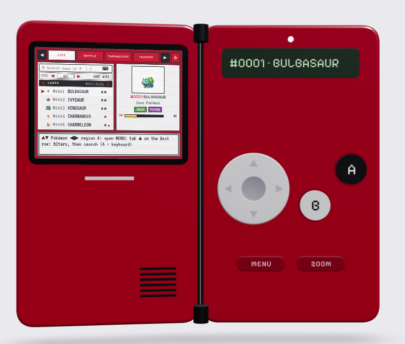
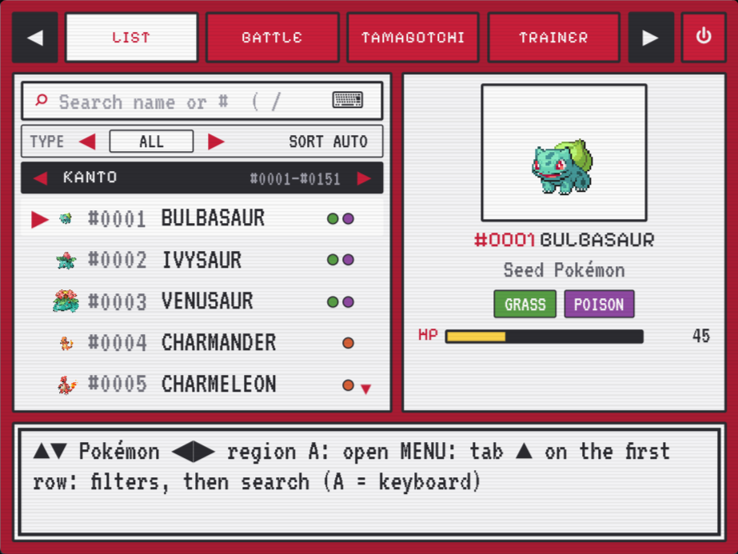
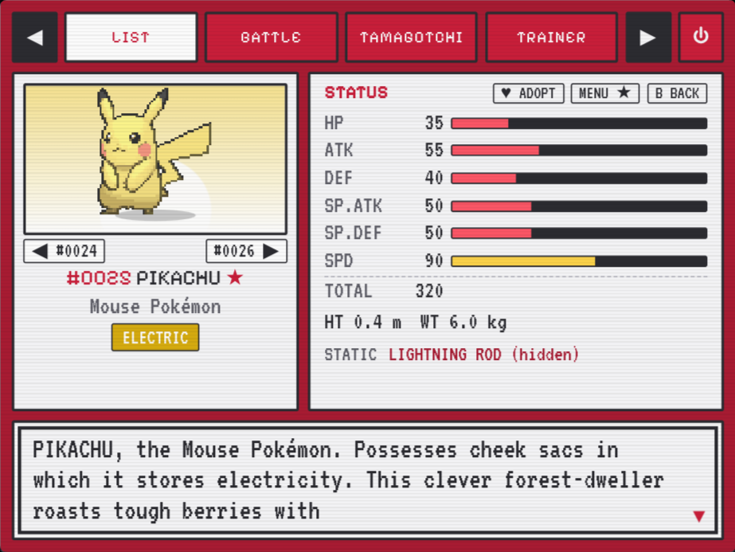
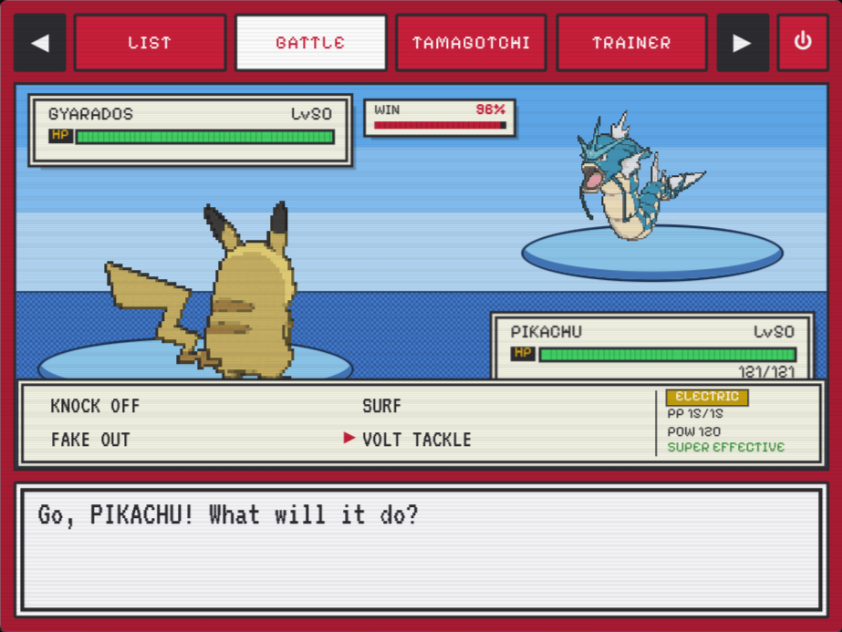
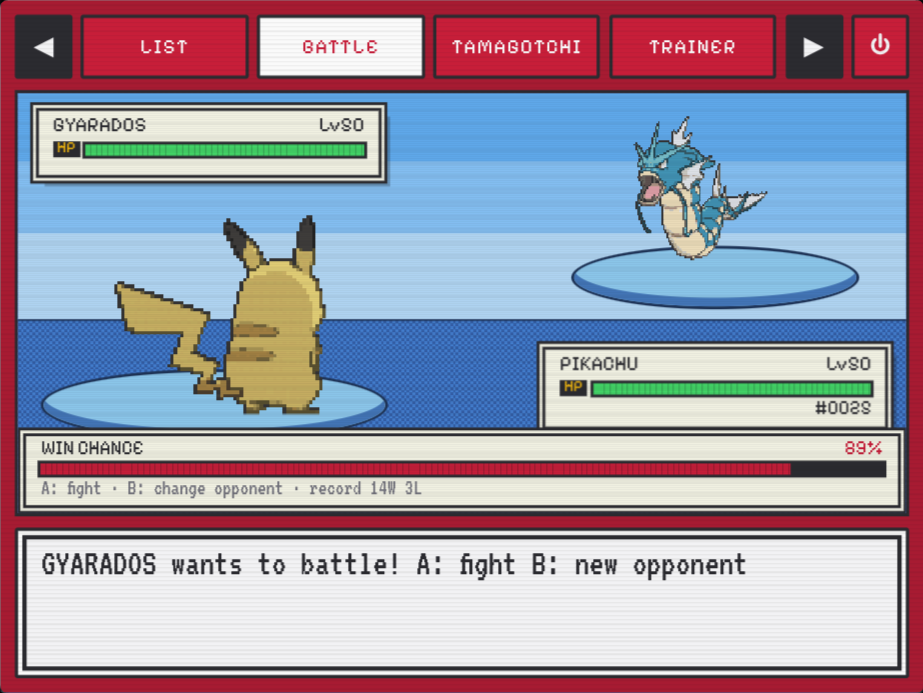
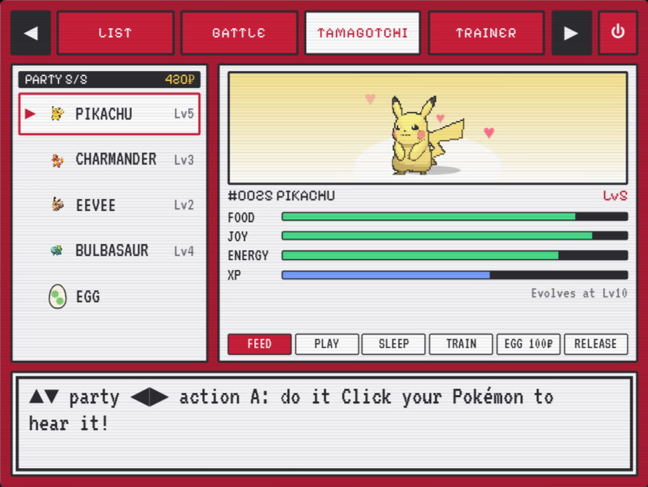
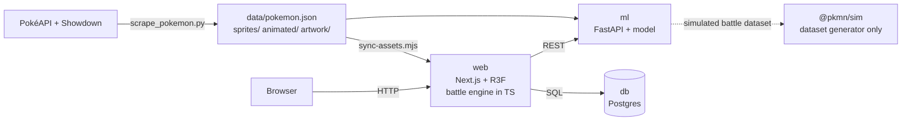

# Pokédex Game

An interactive 3D Pokédex with battles, machine-learning win prediction and a Tamagotchi. A non-profit fan project built for portfolio and learning purposes, developed with **agentic programming** using [Claude Code](https://claude.com/claude-code).

> **Status:** in development. Working today: the **data scraper**, a **procedural 3D device** (spring hinge, pressable buttons, zoom camera, sound, gamepad, phone layout), a full **Pokédex** (search, regions with music, filters, favorites, fun facts), a **Tamagotchi**, a **battle screen** with the pre-battle win chance (a model that runs in the browser). You can already **fight 1v1** on a hand-built, tested battle engine. Still to come: 6v6 teams, Docker, a database and the trainer profile. Anything marked _(planned)_ below is not implemented yet.

## Table of contents

- [Built with agentic programming](#built-with-agentic-programming)
- [Features](#features)
- [Screenshots](#screenshots)
- [Architecture](#architecture)
- [Stack](#stack)
- [Project structure](#project-structure)
- [Getting started](#getting-started)
- [Training the model](#training-the-model)
- [Data structures and algorithms](#data-structures-and-algorithms)
- [Roadmap](#roadmap)
- [Controls](#controls)
- [Legal notice](#legal-notice)
- [Credits](#credits)

## Built with agentic programming

This project is developed in pair with an AI coding agent (Claude Code). The workflow:

- **I set the direction:** the product idea, the roadmap, the design decisions and the review of every change.
- **The agent does the legwork:** it reads the codebase, proposes and implements changes, runs the linter and the dev server, and fixes what breaks.
- **Small, reviewable commits:** work is split into focused steps and committed with [Conventional Commits](https://www.conventionalcommits.org/) (`feat(screen): ...`, `fix(screen): ...`, `chore(web): ...`).
- **Agent guidance lives in the repo:** [`web/AGENTS.md`](web/AGENTS.md) tells coding agents to read the bundled Next.js docs before writing code, since this Next.js version has breaking changes compared to older releases.

The commit history shows how the project grew step by step: scraper, web scaffold, input system, retro UI prototype, 3D shell, the Pokédex (search, regions, filters, fun facts), the Tamagotchi, and the win-prediction pipeline. Conventions for agents are in [`CLAUDE.md`](CLAUDE.md).

## Features

| Feature | Description | Status |
| --- | --- | --- |
| Data scraping | Script that downloads data, sprites, artwork and animated sprites for all 1025 Pokémon (generations 1 to 9) from PokéAPI and Pokémon Showdown | ✅ Done |
| 3D device | Original red device built procedurally with React Three Fiber, with every measurement in `device.config.ts`. The screen half opens to the left like a book cover on a spring hinge; idle float while closed; retro boot animation; status LED; secondary screen with the focused Pokémon. Drag to rotate, zoom into the main screen. Physical buttons (D-pad, A, B, MENU, ZOOM) are pressable in 3D | ✅ Done |
| Phone layout | On touch screens in portrait, all the buttons move next to the screen on one half, the lid opens flat and the camera frames just that half (rotation off, so a finger on a button doesn't turn the device). It zooms into the screen as soon as the device opens. Force it with `?layout=compact` (or `?layout=split`) | ✅ Done |
| Input system | Keyboard, gamepad and 3D buttons emit the same events through a priority-based handler stack. Held directions repeat | ✅ Done |
| Sound | Synthesized UI blips (WebAudio) and Pokémon cries played from the speaker grill (positional audio). Mute button; audio starts after the first interaction | ✅ Done |
| Pokédex screen | 4:3 retro handheld UI inside the device. Scrollable list of all 1025 Pokémon with a preview panel, and a detail page with animated sprite, types, base stats, height, weight, abilities and a typewriter-style dialog box with the dex entry. Respects `prefers-reduced-motion` | ✅ Done |
| Search | Search by name prefix (binary search, results A→Z) or by number (`25`, `#25`). Type with the real keyboard (`/` focuses the field) or with the device buttons on an on-screen keyboard | ✅ Done |
| Regions and music | The list shows the region of the focused Pokémon (Kanto … Paldea, by dex number); ◀ ▶ jump between regions. Each region has its own background music, which crossfades when the cursor crosses a region boundary. The themes are original synthesized chiptune loops (no game music is bundled); your own recordings can be mapped per region in `web/lib/music.ts`. Battles have three driving themes with drums and arpeggios: two picked at random per battle and a heavier one for legendary and mythical foes | ✅ Done |
| Filters, sorting and favorites | Options row above the list: filter by type or ★ favorites, sort by number, name or base stat total. Rows show a mini sprite, type dots and the searched prefix highlighted. Favorites (MENU on a Pokémon page) are saved in `localStorage`. Jumping past Paldea shows a "Gen X: coming soon" slot | ✅ Done |
| Fun facts | Each Pokémon page ends with three "Did you know?" facts computed from the data by comparing it with all 1025 Pokémon: stat total ranking, top-1% stats, rare typings ("the only Bug/Ghost Pokémon"), size extremes or weight in Pikachu, catch rate, branched evolutions… (`web/lib/funFacts.ts`) | ✅ Done |
| Battle screen | BATTLE tab: first choose your Pokémon and then the opponent (★ favorites first, then your Tamagotchi party; searchable with the on-screen keyboard or `/`), then see yours from the back against the opponent, on a backdrop picked from the foe's type (field, sea, snow, volcano, rocky, cave, mystic, sky, power), with status boxes, the **pre-battle win chance** and an original battle theme. Then you fight: pick a move from a 2×2 menu (type, PP, power and SUPER EFFECTIVE / NOT VERY EFFECTIVE hints against the foe), the foe answers, and the turn plays back event by event (messages, HP bars, hits, sounds; A skips ahead). Winning pays 15 coins for the Tamagotchi shop, and if your Pokémon is in your Tamagotchi party it gains XP and joy (and can evolve). Each Pokémon keeps a win/loss record, shown before the fight. During the fight a live win chance is re-estimated every turn by simulating the rest of the battle 200 times in the browser (Monte Carlo with the same engine and AI); warning beeps play when your Pokémon drops below 20% HP. MENU can't switch tabs mid-fight. 16-bit look with flat sky bands, dithered ground, segmented HP bars and scanlines | ✅ Done |
| 1v1 battle engine | Pure TypeScript engine built by hand (`web/lib/battle`), no `@pkmn/sim` at runtime. Standard gen 5+ rules: priority then speed (paralysis halves it), damage formula with the 85–100% roll, STAB, type chart, critical hits, accuracy, stat stages, PP; burn, paralysis, poison, bad poison and sleep with type immunities; drain, recoil, healing, multi-hit, fixed-damage moves and chance effects; flinch, confusion, Protect, Leech Seed, locked moves (Outrage) and recharge turns (Hyper Beam); type-based move immunities (Thunder Wave vs Ground, powders vs Grass); special moves common in the sets (Fake Out and First Impression on the first turn only, Sucker Punch, Focus Punch, Rest, Super Fang, Pain Split, Belly Drum, Haze). Abilities and items are not modeled, and moves with other effects (Substitute...) just fail. `runTurn` returns the new state plus the events for the screen to play back. A greedy AI picks the foe's moves: it takes the surest KO when it has one and never wastes status moves that wouldn't work. Unit-tested | ✅ Done |
| 6v6 battles | Team battles on top of the 1v1 engine | 🕒 Planned |
| Win prediction | Win chance **before the battle**, shown on the battle screen. Gradient boosting trained on 79,985 simulated battles (AUC 0.93, calibration error 0.1%), exported to JSON and run **in the browser** (no server needed); the FastAPI service is optional | ✅ Done |
| Tamagotchi | Adopt up to 5 Pokémon from the list (A at the end of a Pokémon page, or ♥ ADOPT). Food, joy and energy decay with real time; feed, play, sleep and train them. XP raises the level and they **evolve** (babies also need to be happy). Coins earned by playing and training buy **eggs** that hatch into a random base-stage or baby Pokémon. Hearts when happy, mood bubbles, reactions per action, idle animation by evolution stage, and clicking one plays its cry. A blinking "!" on the tab when one is hungry, tired or sad, or an egg is ready. Saved in `localStorage` | ✅ Done (v1) |
| Trainer profile | Create your own trainer profile: pick a name, design your trainer sprite (hair, outfit, colors, etc.) and show it on the device. The profile ties together your Tamagotchi, favorites and battle history | 🕒 Planned |


## Screenshots

_Placeholders. They will be added as the screens are finished._

| 3D device | Pokédex list | Details |
| --- | --- | --- |
|  |  |  |

| Battle | Win prediction | Tamagotchi |
| --- | --- | --- |
|  |  |  |

## Architecture

The scraper, the `web` app and the `ml` service exist today. The battle engine runs in the browser (`web/lib/battle`, pure TypeScript, so no API routes are needed). The database and Docker are _(planned)_. The pre-battle win chance runs in the browser from an exported model (`web/public/battle/win-model.json`); the FastAPI service is optional.



Planned Docker Compose services: **web**, **ml** and **db**. For now the Tamagotchi and favorites live in `localStorage`; Postgres comes later for persistence and history.

Inside `web`, the app is split into three layers:

- **Stores (zustand):** `deviceInput` (button events, hold-to-repeat and subscriptions), `deviceState` (phase state machine: `CLOSED → OPENING → OPEN → ZOOMING_IN → ZOOMED → ZOOMING_OUT → OPEN → CLOSING`), `pokedex` (loading, focus, selection and cries), `favorites` and `tamagotchi` (both persisted in `localStorage`) and `audio` (mute and unlock).
- **Device (`components/device`):** the procedural 3D shell, hinge, buttons and camera rig. The scene is loaded lazily. Conventions for working on it are in [`CLAUDE.md`](CLAUDE.md).
- **Screen (`components/screen`):** the 2D UI rendered inside the main screen. It subscribes to device input with higher priority than the device controller, so the UI gets the first say on each button.
- **Logic (`lib/`):** pure, unit-tested modules with no React: search, regions, listing (filters and sorting), fun facts, Tamagotchi rules, sound and music synthesis, the 1v1 battle engine (`lib/battle`), and the battle features and type chart shared with the ML pipeline.

## Stack

| Layer | Technologies |
| --- | --- |
| Front end | Next.js 16 (App Router), React 19, TypeScript, React Three Fiber, drei, three.js, camera-controls, zustand |
| Battle | Own TypeScript engine (`web/lib/battle`); `@pkmn/sim` only to generate the ML dataset |
| ML | Python, scikit-learn, pandas, FastAPI; dataset generator in Node with `@pkmn/sim` |
| Persistence | `localStorage` today; Postgres _(planned)_ for the Tamagotchi and history |
| Infra _(planned)_ | Docker and Docker Compose |
| Data scraping | Python 3, standard library only |

## Project structure

Entries marked _(planned)_ do not exist yet.

```
pokedex-game/
├── scrape_pokemon.py       # scrapes data and images from PokéAPI / Showdown
├── data/
│   └── pokemon.json        # 1025 Pokémon (raw cache in data/cache/, git-ignored)
├── sprites/                # <id>.png, small sprite (back/ has the back views)
├── artwork/                # <id>.png, high-resolution official artwork
├── animated/               # <id>.gif, animated sprite (back/ has the back views; git-ignored)
├── web/                    # Next.js app
│   ├── app/                # App Router entry
│   ├── components/
│   │   ├── device/         # 3D shell; all measurements in device.config.ts
│   │   └── screen/         # Pokédex UI inside the 4:3 screen
│   ├── hooks/              # keyboard/gamepad input, device controller and layout, sound, music, screen power
│   ├── stores/             # zustand stores (deviceInput, deviceState, pokedex, favorites, tamagotchi, audio)
│   ├── lib/                # search, regions, listing, fun facts, Tamagotchi rules, sound/music, battle features, battle/ (the 1v1 engine) (+ tests)
│   ├── data/               # Pokémon types and helpers
│   ├── scripts/
│   │   └── sync-assets.mjs # copies images and builds public/data/pokedex.json
│   └── AGENTS.md           # guidance for coding agents
├── ml/                     # win prediction (see ml/README.md)
│   ├── generate/           # Node: simulates battles with @pkmn/sim and writes the datasets
│   ├── pokedex_ml/         # Python: training, Monte Carlo evaluation, FastAPI
│   ├── tests/              # pytest
│   └── reports/            # metrics.json, montecarlo.json
├── CLAUDE.md               # conventions for coding agents (commits, 3D device)
├── docker-compose.yml      # (planned) web, ml, db
├── .env.example            # (planned)
└── README.md
```

## Getting started

### 1. Scrape the data

Requires only Python 3, no dependencies to install.

```bash
python3 scrape_pokemon.py              # all 1025 Pokémon
python3 scrape_pokemon.py --limit 151  # first generation only
python3 scrape_pokemon.py --no-images  # JSON only, no images
python3 scrape_pokemon.py --workers 4  # fewer parallel requests
```

The script is resumable: API responses are cached in `data/cache/` and images already downloaded are skipped. Alternate forms (mega, regional, etc.) are not included, only the default forms. Animated GIFs come from PokéAPI's Showdown sprites; for Pokémon it lacks, the scraper tries Showdown's Gen 5 style GIFs (`sprites/gen5ani/`). That leaves 1017 of 1025 animated; the other 8 (#990, #991, #993, #1010, #1017, #1022, #1023, #1025) use the static sprite.

Fields of each Pokémon in `data/pokemon.json`:

`id`, `name`, `display_name`, `genus`, `description`, `types`, `height_m`, `weight_kg`, `base_experience`, `stats`, `abilities`, `color`, `habitat`, `generation`, `is_legendary`, `is_mythical`, `capture_rate`, `evolves_from`, `evolution_chain_id`, `sprite`, `artwork`, `animated`, `back_sprite`, `animated_back`, `sprite_url`, `artwork_url`, `animated_url`, `back_sprite_url`, `animated_back_url`, `cry_url`, `evolves_from_id`, `is_baby`.

> Cries are not downloaded: the app streams them from `cry_url` (PokéAPI cries repository). Fun facts are computed in the app from these fields, not scraped.

### 2. Run the web app

Requires Node.js and npm.

```bash
cd web
npm install
npm run dev
```

Then open http://localhost:3000. `npm run dev` and `npm run build` first run `npm run sync-assets`, which copies `sprites/` and `animated/` into `web/public/` and builds a trimmed `web/public/data/pokedex.json` from `data/pokemon.json`. In that file, `animated` is the local `/animated/<id>.gif` when it exists, otherwise the remote `animated_url`, or `null` (static sprite); `animatedBack` works the same way for the back view used on the battle screen. If the scraper has not been run, the script warns and the Pokédex will fail to load.

> **Deploying (e.g. Vercel):** `animated/` is git-ignored (~72 MB), so a deploy does not have the GIFs and the app loads them from the remote URLs (PokéAPI sprites on GitHub and Showdown). If they go offline, the UI falls back to the static PNGs. The build also needs `sprites/` and `data/` from outside `web/`, so keep Vercel's "Include source files outside of the Root Directory" enabled when the Root Directory is `web`.

```bash
npm run lint    # ESLint
npm test        # unit tests (lib/)
npm run build   # production build
npm run start   # serve the production build
```

### 3. Win-prediction service (optional)

See [`ml/README.md`](ml/README.md) for the full steps (generate data, train, serve). Once the service is running on port 8000, the app can call it (`NEXT_PUBLIC_ML_API_URL`, default `http://localhost:8000`).

### 4. Full application _(planned)_

```bash
cp .env.example .env
docker compose up
```

Planned environment variables for `.env.example` (names may change):

| Variable | Purpose |
| --- | --- |
| `DATABASE_URL` | Postgres connection |
| `ML_API_URL` | URL of the FastAPI service used by `web` |
| `POSTGRES_USER` / `POSTGRES_PASSWORD` / `POSTGRES_DB` | Credentials for the `db` service |

## Training the model

Full details, commands and results in [`ml/README.md`](ml/README.md). In short:

1. **Battle state contract:** `BattleSnapshot` in `web/lib/battleFeatures.ts` is the engine-neutral 1v1 state. The features (turns to KO with the damage formula, damage share, turn order, damage race, HP, type advantage, stats, status) are computed there, once, and shared by the dataset generator and the app.
2. **Dataset:** `ml/generate` simulates thousands of battles through a `BattleEngine` interface. Today the adapter is `@pkmn/sim` (Showdown, gen 9); the project's own engine (`web/lib/battle`) will get its own adapter, so the model learns its rules. Greedy agents play both sides; every turn is a row, mirrored from the other side so the model is symmetric.
3. **Training:** logistic regression vs. gradient boosting, cross-validated **by battle** (GroupKFold), with log loss, Brier, AUC, calibration and a test on species never seen in training. Pre-battle model: AUC 0.93, calibration error 0.14%, against 0.79 for a "who wins the damage race" heuristic.
4. **Comparison with Monte Carlo:** replaying fixed matchups hundreds of times; the model is thousands of times faster with a mean error of 0.12 against it.
5. **Serving:** the trees are exported to JSON and evaluated in the browser (`web/lib/winModel.ts`, tested to match scikit-learn), so the battle screen works without a server. FastAPI (`/predict`) is used instead when `NEXT_PUBLIC_ML_API_URL` is set.

## Data structures and algorithms

### Prefix search with binary search

Implemented in [`web/lib/search.ts`](web/lib/search.ts), with tests in `web/lib/search.test.ts` (`npm test` in `web/`).

When the Pokédex loads, a search index is built once: the Pokémon **sorted by normalized name** (lowercase, accents removed, so "flabe" finds Flabébé). For a prefix search (the user types "c" and sees every Pokémon starting with C, in alphabetical order), binary search finds the **first position** whose name is `>= prefix` (a _lower bound_), then the code scans forward while names still start with the prefix. All matches are contiguous in the sorted list, so the scan touches only the results.

**Why:**

- The data is static (1025 items), so sorting once pays off.
- Filtering the whole list on every keystroke costs `O(n)`; here the cost is lower and predictable.
- No extra structure such as a trie is needed, which would spend more memory for a small gain at this size.

**Complexity:**

| Operation | Cost |
| --- | --- |
| Sort (once) | `O(n log n)` |
| Find the start of the range | `O(log n)` |
| Collect the `k` results | `O(k)` |
| Full search | `O(log n + k)` |

A numeric query (`25`, `#25`, `#0025`) is an exact lookup by number in a `Map`, `O(1)`.

### Region of a Pokémon

Regions are contiguous dex ranges sorted by their first number ([`web/lib/regions.ts`](web/lib/regions.ts)). The region of an id is found with a binary search for the last range starting at or before it, `O(log r)`; the tests check every boundary (e.g. #151 Kanto, #152 Johto) against a linear scan.

The tests cover the lower bound edges, case/accent handling, number lookups and a comparison against a brute-force filter on 500 prefixes.

## Roadmap

Done:

- [x] Data and image scraper (PokéAPI and Showdown, 1025 Pokémon, 1017 animated)
- [x] Next.js scaffold with R3F, drei and zustand
- [x] Input system (keyboard, gamepad and 3D buttons)
- [x] Procedural 3D device: phase state machine, spring hinge, boot animation, sound, cries, phone layout
- [x] Pokédex screen: list, preview and detail page for all 1025 Pokémon
- [x] Search by name prefix (binary search) or number, with an on-screen keyboard
- [x] Region bar and per-region background music
- [x] Type filter, sorting, favorites and a "coming soon" slot for the next generation
- [x] Fun facts
- [x] Tamagotchi v1 (party of 5, needs, evolution, eggs)
- [x] Win-prediction model v1: dataset generator, training, Monte Carlo evaluation, FastAPI
- [x] Battle screen with backdrops, battle music and the pre-battle win chance
- [x] 1v1 battle: engine with the standard rules and a greedy foe AI (`web/lib/battle`), and the fight screen

Next:

- [ ] **Phase 1:** Docker
- [ ] **Phase 2:** polish the 3D device around the interface
- [ ] **Phase 5:** 6v6 battle
- [ ] **Phase 6:** Tamagotchi in Postgres (history, sync across devices)
- [ ] **Phase 7:** Trainer profile (name and customizable sprite)

## Controls

Keyboard and the physical buttons on the device do the same thing. Each key maps to the same button event that clicking the 3D button emits.

| Keyboard | Device button | Action |
| --- | --- | --- |
| ↑ ↓ ← → | D-pad | Navigate (hold to repeat: 300 ms, then every 90 ms). In the list, ↑ ↓ move and ← → jump between regions; ↑ on the first row selects the filter/sort row (← → change the filter, A the sort), and ↑ again the search field. On a Pokémon page they step through the National Dex. On the on-screen keyboard they move between keys |
| `Z` | A | Confirm / open details / advance the dialog / open the keyboard / type a key |
| `X` | B | Go back (clears the search; deletes a letter on the keyboard); at the root, leave zoom |
| `Enter` | MENU | Next tab (List, Battle, Tamagotchi); on a Pokémon page, toggle ★ favorite; on the keyboard, done |
| `Space` | ZOOM | Zoom in or out of the screen (opens the device if closed) |
| `Esc` | n/a | Leave zoom (in the search field: clear it, then leave the field) |
| `/` | n/a | Focus the search field. While typing, ↑ ↓ move through the results and `Enter` opens one |

On the BATTLE tab: pick your Pokémon and then the opponent from the lists (A confirms, B goes back). In the arena, A starts the battle, the D-pad moves through the 2×2 move menu, A uses the move and B runs away; A skips the messages while a turn plays. When it ends, A fights again and B returns to the lists.

On the TAMAGOTCHI tab: ↑ ↓ pick a Pokémon from the party, ← → pick an action, A does it, B goes back to the list.

Gamepads with the standard mapping also work: D-pad or left stick, A/B (bottom/right face buttons), Start = MENU, Select or Y = ZOOM. Opening: click the cover, press A, or use the "Open device" page button. Closing: the ⏻ button on the screen, a click on the hinge, or the page button.

The mapping may still change during development.

## Legal notice

Pokémon and all related names, images and sounds are trademarks and property of Nintendo, Game Freak and The Pokémon Company. This is a non-profit fan project with no affiliation with these companies. The device design is original.

## Credits

- [PokéAPI](https://pokeapi.co/): Pokémon data, sprites, artwork and cries.
- [Pokémon Showdown](https://play.pokemonshowdown.com/): animated sprites.
- [`@pkmn/sim`](https://github.com/pkmn/ps): battle engine based on Pokémon Showdown.
- [Pixelify Sans](https://fonts.google.com/specimen/Pixelify+Sans): pixel font, licensed under the SIL OFL.
- [Claude Code](https://claude.com/claude-code): AI coding agent used to build the project.
