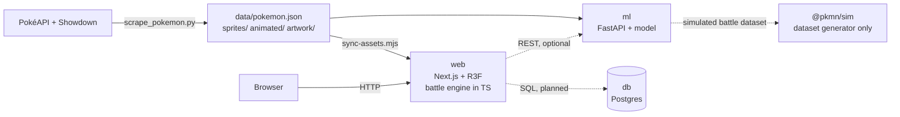

# Pokédex Game

An interactive 3D Pokédex with turn-based battles, in-browser win-probability prediction and a Tamagotchi. Built as a portfolio project with a procedural React Three Fiber device, a hand-written battle engine and a machine-learning pipeline.

> Non-profit fan project, not affiliated with Nintendo, Game Freak or The Pokémon Company. See the [legal notice](#legal-notice).

**Status:** in development. The scraper, the 3D device, the Pokédex, the Tamagotchi, the trainer profile and 1v1 / 3v3 / 6v6 battles with win prediction are working. Docker and a database are planned (marked _(planned)_ below).

## Table of contents

- [Highlights](#highlights)
- [Features](#features)
- [Screenshots](#screenshots)
- [Architecture](#architecture)
- [Tech stack](#tech-stack)
- [Project structure](#project-structure)
- [Getting started](#getting-started)
- [Controls](#controls)
- [Win-prediction model](#win-prediction-model)
- [Data structures and algorithms](#data-structures-and-algorithms)
- [Development workflow](#development-workflow)
- [Roadmap](#roadmap)
- [Legal notice](#legal-notice)
- [Credits](#credits)

## Highlights

- **Procedural 3D device** with a spring hinge, pressable buttons, a zoom camera, positional sound and a phone layout. No external model needed.
- **Full Pokédex** for all 1025 Pokémon (generations 1 to 9): prefix search, regions with music, filters, favorites and generated fun facts.
- **Own battle engine** in pure TypeScript with standard gen 5+ rules, a foe AI and unit tests. Supports 1v1, 3v3 and 6v6.
- **Win prediction** by a gradient-boosting model that runs entirely in the browser, plus a live Monte Carlo re-estimate every turn.
- **Tamagotchi and trainer profile** with evolution, eggs, coins, a customizable pixel sprite and a trainer card.

## Features

### Device and interface

| Area | Description |
| --- | --- |
| 3D device | Original red handheld built with React Three Fiber. The screen half opens like a book cover on a spring hinge, with idle float, boot animation, status LED and a secondary screen. Drag to rotate, zoom into the main screen. Every measurement lives in `device.config.ts`. |
| Phone layout | On touch screens in portrait, the controls move next to the screen, the lid opens flat and the camera frames one half. Force it with `?layout=compact` or `?layout=split`. |
| Input | Keyboard, gamepad and 3D buttons emit the same events through a priority-based handler stack. Held directions repeat. |
| Sound | Synthesized UI sounds and music (WebAudio), and Pokémon cries played from the speaker grill. Nothing from the games is bundled. |
| Accessibility | Respects `prefers-reduced-motion`: no float, instant hinge and camera, no boot animation. |

### Pokédex

| Area | Description |
| --- | --- |
| Browse | Scrollable list with a preview panel and a detail page: animated sprite, types, base stats, height, weight, abilities and a typewriter dex entry. |
| Search | Prefix search by name (binary search, A→Z) or lookup by number (`25`, `#25`). Real keyboard (`/` to focus) or on-screen keyboard. |
| Regions and music | Region of the focused Pokémon, jump between regions with ◀ ▶, and crossfading chiptune loops per region. |
| Filters and favorites | Filter by type or ★ favorites, sort by number, name or base stat total. Favorites persist in `localStorage`. |
| Fun facts | Three "Did you know?" facts per Pokémon, computed by comparing it with all 1025 (stat rankings, rare typings, size extremes, catch rate…). |

### Battles

| Area | Description |
| --- | --- |
| Modes | Single (1v1), team (3v3) and full (6v6) battles against a chosen or random opponent, with backdrops picked from the foe's type and original battle themes. |
| Fight menu | Classic FIGHT / BAG / POKéMON / RUN flow with type-effectiveness hints, Super Potions, Full Heals and switching. Turns play back event by event. |
| Engine | Hand-written, pure TypeScript (`web/lib/battle`). Priority and speed, damage formula, STAB, type chart, crits, accuracy, stat stages, PP, status conditions, drain, recoil, multi-hit, flinch, confusion, Protect, Leech Seed, locked and recharge moves and several special moves. Abilities and items are not modeled. |
| Foe AI | Greedy: takes the surest KO when available, avoids useless status moves, and in team battles sends out its best matchup and switches out of losing ones. |
| Win chance | Shown before the fight (ML model) and re-estimated every turn (Monte Carlo, 600 simulations per estimate in the browser). Team win chances are simulated, since the model is 1v1. |
| Rewards | Coins for the Tamagotchi shop, XP and joy for party members (they can evolve), and a win/loss record per Pokémon. |

### Tamagotchi and trainer

| Area | Description |
| --- | --- |
| Tamagotchi | Adopt up to 5 Pokémon. Food, joy and energy decay in real time; feed, play, sleep and train. XP raises the level and triggers evolution. Coins buy eggs that hatch into random base-stage Pokémon. Alerts when one needs attention. Saved in `localStorage`. |
| Trainer profile | Pick a name and design an original 24×40 pixel sprite (hair, hat, clothes, shoes, extras), or randomize it. The trainer card shows rank (Rookie → Champion), wins and losses, best partner, party, favorites, coins and start date. |

## Screenshots

| 3D device | Pokédex list |
| --- | --- |
|  |  |

| Pokémon details | Tamagotchi |
| --- | --- |
|  |  |

## Architecture



The battle engine and the win model run in the browser, so no API routes are needed. The FastAPI service is optional, and Postgres is planned for persistence (for now the Tamagotchi, favorites and trainer live in `localStorage`).

Inside `web`, the code is split into four layers:

- **Stores (zustand):** `deviceInput` (button events, repeat, subscriptions), `deviceState` (phase machine `CLOSED → OPENING → OPEN → ZOOMING_IN → ZOOMED → ZOOMING_OUT → OPEN → CLOSING`), `pokedex`, `favorites`, `tamagotchi`, `battleRecord` and `audio`.
- **Device (`components/device`):** procedural 3D shell, hinge, buttons and camera rig, loaded lazily.
- **Screen (`components/screen`):** the 2D UI rendered inside the main screen. It subscribes to input with higher priority than the device controller, so the UI gets the first say on each button.
- **Logic (`lib/`):** pure, unit-tested modules with no React: search, regions, listing, fun facts, Tamagotchi rules, trainer, sound and music synthesis, the battle engine (rules, AI, Monte Carlo) and the battle features shared with the ML pipeline.

## Tech stack

| Layer | Technologies |
| --- | --- |
| Front end | Next.js 16 (App Router), React 19, TypeScript, React Three Fiber, drei, three.js, camera-controls, zustand |
| Battle | Own TypeScript engine; `@pkmn/sim` only to generate the ML dataset |
| ML | Python, scikit-learn, pandas, FastAPI; Node dataset generator with `@pkmn/sim` |
| Persistence | `localStorage` today; Postgres _(planned)_ |
| Infrastructure | Docker and Docker Compose _(planned)_ |
| Data scraping | Python 3, standard library only |

## Project structure

```
pokedex-game/
├── scrape_pokemon.py       # scrapes data and images from PokéAPI / Showdown
├── data/pokemon.json       # 1025 Pokémon (raw cache in data/cache/, git-ignored)
├── sprites/  artwork/      # static sprites (with back views) and official artwork
├── animated/               # animated sprites (git-ignored)
├── web/                    # Next.js app
│   ├── app/                # App Router entry
│   ├── components/
│   │   ├── device/         # 3D shell; all measurements in device.config.ts
│   │   └── screen/         # UI inside the 4:3 screen
│   ├── hooks/              # input, device controller and layout, sound, music, Tamagotchi alert
│   ├── stores/             # zustand stores
│   ├── lib/                # search, regions, listing, fun facts, Tamagotchi, trainer, audio, battle/ (+ tests)
│   ├── scripts/            # sync-assets.mjs: copies images, builds public/data/pokedex.json
│   └── AGENTS.md           # guidance for coding agents
├── ml/                     # win prediction (see ml/README.md)
│   ├── generate/           # Node: simulates battles with @pkmn/sim, writes datasets
│   ├── pokedex_ml/         # Python: training, Monte Carlo evaluation, FastAPI
│   ├── tests/              # pytest
│   └── reports/            # metrics
├── CLAUDE.md               # conventions for coding agents
├── docker-compose.yml      # (planned)
└── README.md
```

## Getting started

### 1. Scrape the data

Requires Python 3 and no extra dependencies.

```bash
python3 scrape_pokemon.py              # all 1025 Pokémon
python3 scrape_pokemon.py --limit 151  # first generation only
python3 scrape_pokemon.py --no-images  # JSON only
python3 scrape_pokemon.py --workers 4  # fewer parallel requests
```

The script is resumable: API responses are cached in `data/cache/` and existing images are skipped. Only default forms are included (no megas or regional forms). 1017 of 1025 Pokémon have an animated sprite; the other 8 (#990, #991, #993, #1010, #1017, #1022, #1023, #1025) fall back to the static one. Cries are streamed from `cry_url` and not downloaded.

### 2. Run the web app

Requires Node.js and npm.

```bash
cd web
npm install
npm run dev      # http://localhost:3000
```

`npm run dev` and `npm run build` first run `npm run sync-assets`, which copies `sprites/` and `animated/` into `web/public/` and builds a trimmed `web/public/data/pokedex.json`. Without the scraped data the Pokédex fails to load.

```bash
npm run lint     # ESLint
npm test         # unit tests (lib/)
npm run build    # production build
npm run start    # serve the production build
```

> **Deploying (e.g. Vercel):** `animated/` is git-ignored (~72 MB), so a deploy loads the GIFs from remote URLs and falls back to static PNGs if they are offline. The build needs `sprites/` and `data/` from outside `web/`, so keep Vercel's "Include source files outside of the Root Directory" enabled when the Root Directory is `web`.

### 3. Win-prediction service (optional)

The app already ships the exported model. To retrain it or serve it through FastAPI, follow [`ml/README.md`](ml/README.md). With the service on port 8000, set `NEXT_PUBLIC_ML_API_URL` (default `http://localhost:8000`).

### 4. Full stack with Docker _(planned)_

```bash
cp .env.example .env
docker compose up
```

| Variable | Purpose |
| --- | --- |
| `DATABASE_URL` | Postgres connection |
| `ML_API_URL` | URL of the FastAPI service used by `web` |
| `POSTGRES_USER` / `POSTGRES_PASSWORD` / `POSTGRES_DB` | Credentials for the `db` service |

## Controls

Keyboard, gamepad and the 3D buttons emit the same events.

| Keyboard | Device button | Action |
| --- | --- | --- |
| ↑ ↓ ← → | D-pad | Navigate (hold to repeat: 300 ms, then every 90 ms). In the list, ↑ ↓ move and ← → jump between regions; ↑ on the first row reaches the filter/sort row, then the search field. On a Pokémon page they step through the National Dex. |
| `Z` | A | Confirm, open details, advance dialog, type a key |
| `X` | B | Go back (clears the search, deletes a letter); at the root, leave zoom |
| `Enter` | MENU | Next tab (List, Battle, Tamagotchi, Trainer); on a Pokémon page, toggle ★ favorite |
| `Space` | ZOOM | Zoom in or out of the screen (opens the device if closed) |
| `Esc` | n/a | Leave zoom (in the search field: clear, then leave) |
| `/` | n/a | Focus the search field |

Gamepads with the standard mapping also work: D-pad or left stick, A/B, Start = MENU, Select or Y = ZOOM. To open the device: click the cover, press A, or use the page button. To close it: the ⏻ button on the screen, a click on the hinge, or the page button.

<details>
<summary>Per-tab controls</summary>

- **Battle:** pick SINGLE, TEAM (3v3) or FULL BATTLE (6v6), then your Pokémon and the opponent (A confirms, B goes back or undoes the last pick). In the arena, A starts the battle; the D-pad moves through FIGHT / BAG / POKéMON / RUN, A confirms, B goes back, and A skips messages while a turn plays. When it ends, A fights again and B returns to the lists.
- **Tamagotchi:** ↑ ↓ pick a Pokémon, ← → pick an action, A does it, B goes back.
- **Trainer:** A creates or edits the profile. In the editor, ↑ ↓ pick a row, ← → change it, A on NAME opens the keyboard, MENU saves and B cancels.

</details>

The mapping may still change during development.

## Win-prediction model

Full details, commands and results are in [`ml/README.md`](ml/README.md).

1. **Shared battle contract:** `BattleSnapshot` in `web/lib/battleFeatures.ts` is the engine-neutral 1v1 state. Features (turns to KO, damage share, turn order, HP, type advantage, stats, status, moveset features) are computed there once and used by both the dataset generator and the app.
2. **Baseline (hard labels):** ~80,000 battles simulated with `@pkmn/sim` (gen 9). Gradient boosting reached AUC 0.93 with ~0.14% calibration error, against 0.79 for a "who wins the damage race" heuristic, cross-validated by battle (GroupKFold) and tested on unseen species.
3. **Shipped model (soft labels):** trained on the battles the app actually plays (its own engine and movesets). Each of 25,000 random matchups is simulated 100 times with the AI on both sides and the win rate is the label. Mean error 0.065 against 1,000-simulation estimates (correlation 0.96), down from 0.077.
4. **Serving:** trees are exported to JSON and evaluated in the browser (`web/lib/winModel.ts`, tested to match scikit-learn). FastAPI (`/predict`) is used instead when `NEXT_PUBLIC_ML_API_URL` is set.
5. **During the fight:** after each turn, a Monte Carlo run of the rest of the battle refines the estimate in chunks (`web/lib/battle/montecarlo.ts`), cancelled when a newer turn arrives.

If movesets change, regenerate the dataset and retrain the model (see `ml/README.md`).

## Data structures and algorithms

### Prefix search with binary search

[`web/lib/search.ts`](web/lib/search.ts), tested in `web/lib/search.test.ts`.

On load, an index is built once: Pokémon **sorted by normalized name** (lowercase, accents removed, so "flabe" finds Flabébé). A prefix search uses binary search to find the first name `>= prefix` (a _lower bound_), then scans forward while names still match. All matches are contiguous, so the scan touches only the results.

| Operation | Cost |
| --- | --- |
| Sort (once) | `O(n log n)` |
| Find the start of the range | `O(log n)` |
| Collect the `k` results | `O(k)` |
| Full search | `O(log n + k)` |

A numeric query (`25`, `#25`, `#0025`) is an exact `Map` lookup, `O(1)`. A trie was not needed: at 1025 items it would cost more memory for little gain.

### Region of a Pokémon

Regions are contiguous dex ranges sorted by start ([`web/lib/regions.ts`](web/lib/regions.ts)). The region of an id is a binary search for the last range starting at or before it, `O(log r)`. Tests check every boundary (e.g. #151 Kanto, #152 Johto) against a linear scan, and the search tests compare against a brute-force filter on 500 prefixes.

## Development workflow

This project is developed in pair with an AI coding agent ([Claude Code](https://claude.com/claude-code)). I set the direction (product, roadmap, design decisions) and review every change; the agent reads the codebase, implements, runs the linter and the dev server, and fixes what breaks.

- **Small, reviewable commits** following [Conventional Commits](https://www.conventionalcommits.org/) (`feat(screen): …`, `fix(screen): …`, `docs: …`).
- **Agent guidance lives in the repo:** [`CLAUDE.md`](CLAUDE.md) holds the conventions (3D device, battle engine, commits) and [`web/AGENTS.md`](web/AGENTS.md) tells agents to read the bundled Next.js docs first, since this Next.js version has breaking changes.
- **Quality gates:** `npx tsc --noEmit`, `npx eslint .` and `npm test` in `web/` must be clean.

## Roadmap

Done:

- [x] Data and image scraper (1025 Pokémon, 1017 animated)
- [x] Next.js scaffold with R3F, drei and zustand
- [x] Input system (keyboard, gamepad, 3D buttons)
- [x] Procedural 3D device: state machine, spring hinge, boot animation, sound, cries, phone layout
- [x] Pokédex: list, preview, details, binary-search lookup, on-screen keyboard
- [x] Regions with music, filters, sorting, favorites, fun facts
- [x] Tamagotchi v1 (party of 5, needs, evolution, eggs)
- [x] Win-prediction pipeline: dataset generator, training, Monte Carlo evaluation, FastAPI
- [x] Battle engine and screen: 1v1, 3v3 and 6v6, items, switching, rewards
- [x] Trainer profile

Next:

- [ ] **Phase 1:** Docker
- [ ] **Phase 2:** polish the 3D device around the interface
- [ ] **Phase 6:** Tamagotchi in Postgres (history, sync across devices)

## Legal notice

Pokémon and all related names, images and sounds are trademarks and property of Nintendo, Game Freak and The Pokémon Company. This is a non-profit fan project with no affiliation with these companies. The device design is original.

## Credits

- [PokéAPI](https://pokeapi.co/): Pokémon data, sprites, artwork and cries.
- [Pokémon Showdown](https://play.pokemonshowdown.com/): animated sprites.
- [`@pkmn/sim`](https://github.com/pkmn/ps): battle engine used to generate the ML dataset.
- [Pixelify Sans](https://fonts.google.com/specimen/Pixelify+Sans): pixel font, SIL OFL.
- [Claude Code](https://claude.com/claude-code): AI coding agent used to build the project.
